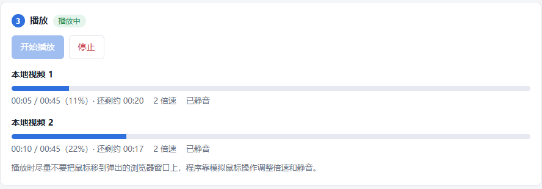

# YuketangAutoPlayer

雨课堂视频自动播放工具：扫码登录、点选课程、一键开始，多个视频同时以 2 倍速静音播放，播完自动换下一个，直到整门课的视频全部看完。

基于 Selenium 驱动本机 Chrome，无需虚拟机，也支持无窗口运行。本项目 fork 自 [LetMeFly666/YuketangAutoPlayer](https://github.com/LetMeFly666/YuketangAutoPlayer)，在原有脚本基础上增加了网页控制台、多视频并行播放等功能。



## 新版亮点

| | 原版脚本 | 本版本 |
| --- | --- | --- |
| 操作方式 | 手动编辑 `config.ini` 后运行脚本 | 本地网页控制台，全程点按钮 |
| 登录 | 手动从开发者工具复制 `sessionid` | 微信扫码，登录态自动保存；失效时自动弹出扫码 |
| 选课 | 手动复制课程地址 | 自动读取课程列表，点「选这门课」即可 |
| 播放数量 | 一次一个 | 同时 1~5 个（默认 3 个），播完自动补位 |
| 倍速 | 尝试切到 2 倍速 | 固定 2 倍速；播放器重置速度、视频暂停时自动恢复并续播 |
| 后台播放 | 未特别处理 | 关闭 Chrome 后台节流，多个标签页在后台也持续播放 |
| 进度查看 | 看命令行输出 | 每个视频独立进度条、剩余时间、播放截图、运行日志 |
| 平台 | 手动填写对应域名的课程地址 | 控制台选择普通 / 荷塘 / 长江 / 黄河雨课堂或独立域名，自动记录登录后的实际域名 |
| 页面适配 | 旧版课程页、`www.yuketang.cn` 界面 | 另外兼容新版「学习内容」页（列表嵌在 iframe 中） |
| 无窗口模式 | 视口过小，倍速按钮可能点不到 | 固定 1440×900 视口，并支持在控制台中一键开关 |

## 快速开始

### 1. Windows 一键启动（推荐）

1. 安装 [Chrome 浏览器](https://www.google.cn/chrome/)
2. 下载本项目（`git clone` 或在 GitHub 页面点 Code → Download ZIP 后解压）
3. 双击 **`start.cmd`**

**不需要提前安装 Python。** 第一次运行时，`start.cmd` 会自动调用 `install.cmd` 准备环境：

- 没有 [uv](https://docs.astral.sh/uv/) 时自动安装
- 电脑上没有合适的 Python 时，由 uv 自动下载（不影响电脑上已有的 Python）
- 在项目目录创建 `.venv` 虚拟环境并安装 selenium
- 检查是否装了 Chrome

访问 GitHub 或 PyPI 失败时，脚本会自动改用国内镜像（清华 PyPI、npmmirror）重试。环境装好后再双击 `start.cmd` 会直接打开控制台。之后如果环境坏了，可以单独双击 `install.cmd` 重新检查和修复。

项目目录里没有 `chromedriver.exe` 时，selenium 会在首次运行时自动下载与 Chrome 匹配的版本。如果下载失败，请手动下载[对应版本的 chromedriver](https://googlechromelabs.github.io/chrome-for-testing/) 放到项目目录。

### 2. 手动安装（其他系统，或想自己管理环境）

需要 Chrome 和 Python 3.9+：

```bash
uv venv
uv pip install selenium      # 不用 uv 的话：pip install selenium
python webui.py              # 加 --no-browser 不自动打开页面
```

控制台地址是 `http://127.0.0.1:8765/`，会自动在浏览器中打开；端口被占用时会换一个，以命令行窗口里打印的地址为准。

### 3. 三步开始播放

1. **登录**：首次打开会自动弹出一个 Chrome 窗口，用微信扫码。登录成功后窗口自动关闭，下次打开无需再扫
2. **选择课程**：在课程列表里找到要刷的课，点「选这门课」；按需设置「同时播放」数量和「无窗口模式」
3. **播放**：点「开始播放」，页面上会实时显示每个视频的进度；随时可以点「停止」

> 不是普通雨课堂？在登录卡片中展开「不是普通雨课堂？」，选择荷塘 / 长江 / 黄河雨课堂，或填写学校的独立域名（如 `xxx.yuketang.cn`）。
>
> 列表里找不到课？展开「手动填写课程地址」，粘贴课程「学习内容」页的网址。

## 工作方式

1. 打开课程页，切换到「学习内容」，找出所有**未完成**的视频，跳过已完成、已锁定和已过截止时间的条目
2. 按「同时播放」的数量，在新标签页中依次打开视频，每个视频都会静音并切到 2 倍速
3. 每 3 秒检查一次各视频的进度；视频被暂停、倍速被播放器重置时自动恢复
4. 某个视频自然播放结束后关闭它的标签页，刷新课程列表，补上下一个未完成的视频
5. 没有剩余视频时结束，运行日志显示「全部播放完毕」

雨课堂按实际观看时长记录进度，累计观看约 90% 即算完成；程序会等视频播完再关闭，确保进度上报完整。

## 命令行运行（可选）

不需要网页控制台时，可以直接运行播放脚本，它读取同一份 `config.ini`：

```bash
python main.py
```

首次运行会在程序目录生成 `config.ini` 模板并退出，也可以复制 `config.ini.example`：

```ini
[Settings]
headless = false
course_url = 在此填写你的课程URL
cookie = 在此填写你的sessionid
implicitly_wait = 10
parallel = 3
```

| 配置项 | 说明 |
| --- | --- |
| `headless` | 是否无窗口运行。无窗口时无法扫码，需要已有有效的 `cookie` |
| `course_url` | 课程地址：进入课程，点「学习内容」，复制地址栏里的 https 地址 |
| `cookie` | 登录态 `sessionid`。留空则运行时弹出浏览器扫码，成功后自动写回配置 |
| `implicitly_wait` | 元素查找超时（秒），一般不用改 |
| `parallel` | 同时播放的视频数，1~5，默认 3；设为 1 即逐个播放 |
| `host` | 由网页控制台写入，记录登录所在的域名，命令行脚本不读取 |

环境变量 `YUKETANG_SESSIONID` 优先于配置中的 `cookie`。

<details>
<summary>如何获取课程地址和 cookie（使用控制台时可跳过）</summary>

课程地址：进入课程后点击「学习内容」，复制地址栏。


cookie：登录雨课堂后打开开发者工具，依次点击「应用 → 存储 → Cookie → https&#58;&#47;&#47;xxx.yuketang...」，复制 **sessionid** 的值。


</details>

## 打包为 EXE

```bash
uv pip install pyinstaller
pyinstaller YuketangAutoPlayer.spec --clean
```

打包前需确保项目根目录有 `chromedriver.exe`。生成的 `dist/YuketangAutoPlayer.exe` 内置 chromedriver 和控制台页面，双击即打开网页控制台；`config.ini` 和运行输出保存在 exe 所在目录。

> 上游 Release 中的 [v5.0 exe](https://github.com/LetMeFly666/YuketangAutoPlayer/releases/download/v5.0/YuketangAutoPlayer.exe) 是原版命令行程序，不含本版本的新功能。

## 项目结构

```
webui.py          网页控制台后端（标准库 HTTP 服务，仅监听 127.0.0.1）
webui.html        控制台页面
main.py           播放脚本：查找未完成视频、多开调度、倍速与续播控制
common.py         共用逻辑：配置读写、启动 Chrome、扫码登录、读取课程列表
start.cmd         Windows 一键启动（环境缺失时自动调用 install.cmd）
install.cmd       Windows 环境安装入口，实际逻辑在 install.ps1（安装 uv、Python、selenium）
tests/            回归检查与本地浏览器检查
output/           运行时生成的播放状态和截图，可随时删除
```

## 开发与检查

```bash
uv run python -m unittest discover -s tests -v   # 调度与等待逻辑回归检查，不打开真实课程
uv run python tests/browser_check.py             # 本地 Chrome 检查，无需登录，截图写入 output/verification/
```

本地检查覆盖延迟加载、后台播放、倍速恢复、自动续播、自然结束和控制台渲染；雨课堂真实课程和服务端进度需登录后实测。

## 常见问题

**登录失效了怎么办？**
控制台会显示「登录已失效」。点「刷新列表」或「扫码登录」会重新弹出扫码窗口，扫完即可继续。

**学校用的是独立域名，登录后读不到课程？**
在「不是普通雨课堂？」里选择「其他域名」并填写学校域名。登录后程序会记录实际跳转到的域名，之后都使用该域名。

**视频播完了，雨课堂上还显示未完成？**
进度以雨课堂服务端记录为准，可能有几分钟延迟。程序每次播完都会刷新列表，仍未完成的视频会被再次播放。

**可以一边播放一边用电脑吗？**
可以，播放窗口最小化或放在后台都不影响。尽量不要把鼠标移到程序打开的浏览器上，选择倍速依靠模拟鼠标操作。

**怎么退出？**
先在控制台点「停止」，再关闭命令行窗口。正常播完时浏览器缓存会自动清理；强行结束时，Windows 的 `%temp%` 下可能残留 Chrome 临时目录，可以手动删除。

**安全吗？**
控制台只监听本机，校验请求来源，接口从不返回 `sessionid`；课程列表请求只会发往 `*.yuketang.cn`。`config.ini` 含有你的登录态，不要分享给别人。

## 致谢

感谢原作者 [LetMeFly666](https://github.com/LetMeFly666) 开源的 [YuketangAutoPlayer](https://github.com/LetMeFly666/YuketangAutoPlayer)（[演示视频](https://www.bilibili.com/video/BV15K4y1F7EN/)），以及为原项目做出贡献的各位：

+ [Github@SwordLikeRain](https://github.com/SwordLikeRain)：[Cookie 错误时提示不准确 (#1)](https://github.com/LetMeFly666/YuketangAutoPlayer/issues/1)，促成了扫码登录支持
+ [BiliBili@Bacch](https://space.bilibili.com/21043185)：[报错提醒](https://www.bilibili.com/video/BV15K4y1F7EN/#reply187204230304)，促成了对 selenium ≥ 4.0 的兼容
+ [BiliBili@青鹧不懂蓝桉情](https://space.bilibili.com/1208020409)：提供账号，促成了 `www.yuketang.cn` 界面的支持
+ [Github@420xincheng](https://github.com/420xincheng)：[没刷完视频就自动退出的解决方法 (#8)](https://github.com/LetMeFly666/YuketangAutoPlayer/issues/8)
+ [Github@Guo-Chenxu](https://github.com/Guo-Chenxu)：[`ifVideo` 函数修改 (#13)](https://github.com/LetMeFly666/YuketangAutoPlayer/issues/13)，更新新界面下未完成视频的判断
+ [Github@泠辰](https://github.com/Crsuh2er0)：[已过期视频循环播放 bugfix (#17)](https://github.com/LetMeFly666/YuketangAutoPlayer/pull/17)
+ [Github@ke tan](https://github.com/tkzzzzzz6)：[exe 打包方式 (#18)](https://github.com/LetMeFly666/YuketangAutoPlayer/issues/18)

## 免责声明

本项目仅用于 Selenium 浏览器自动化技术的学习与实践，请勿用于其他用途。使用本项目造成的账号问题或其他损失，与本项目无关。

本项目使用 [LGPL-2.1](LICENSE) 许可证。
